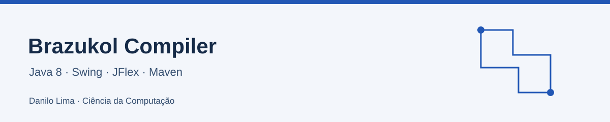
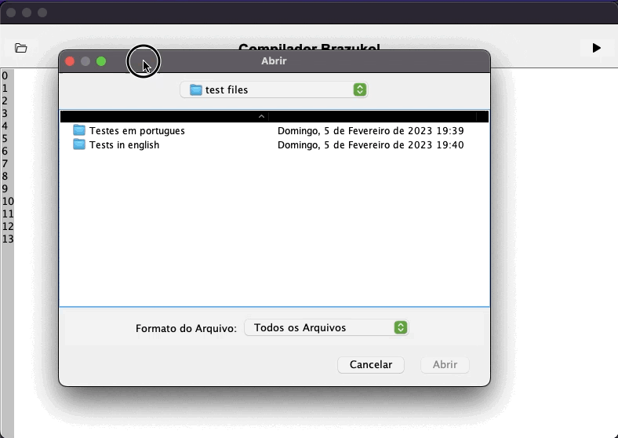

# Brazukol Compiler

Trabalho de Compiladores com uma IDE simples para Brazukol, uma linguagem didática adaptada de Portugol. O projeto permite observar a transformação de texto em tokens e a identificação de erros sintáticos e semânticos.

**Compiladores · Ciência da Computação · UFES**

Java 8 · Swing · JFlex · Maven

[English](README.en.md) · [Meu percurso em Ciência da Computação](https://github.com/Danilo-Js/My-Computer-Science-Course)

<p align="center"></p>

## O que este projeto explora

- Análise léxica e representação de tokens com JFlex.
- Verificações de blocos, procedimentos e terminadores de instrução.
- Checagens de tipo, escopo e uso de break/continue no subconjunto implementado.

## Como explorar

| Caminho | Conteúdo |
|---|---|
| [Análise léxica](src/main/java/com/ufes/compilador/JFlex) | `src/main/java/com/ufes/compilador/JFlex` |
| [Verificações sintáticas](src/main/java/com/ufes/compilador/Syntatic) | `src/main/java/com/ufes/compilador/Syntatic` |
| [Verificações semânticas](src/main/java/com/ufes/compilador/Semantic) | `src/main/java/com/ufes/compilador/Semantic` |
| [Interface](src/main/java/com/ufes/compilador/View) | `src/main/java/com/ufes/compilador/View` |
| [Entradas de exemplo](test%20files) | `test files` |

## Executar ou consultar

O [pom.xml](pom.xml) configura Java 8. É possível importar o projeto Maven no NetBeans ou usar o artefato didático existente:

```bash
java -jar Brazukol.jar
```

Para estudar a construção, use Maven com JDK compatível (`mvn package`) e confira as classes de entrada em `com.ufes.compilador.App.Main`. O JAR histórico e a árvore de fontes devem ser comparados quando forem feitas mudanças funcionais.

## Conceitos e contexto

É uma implementação didática com verificações específicas. Não representa suporte completo a Portugol nem um compilador de uso geral.

## Autoria e procedência

Danilo José Lima de Oliveira, Wesley Wernersbach Aranha, Bernardo Mangaraviti Carrerette, Maria Fernanda Mendes Moreira Mota e Matheus Eliziário Nardi. Trabalho da disciplina ministrada por Rodrigo Freitas Silva.

## Licença

Os termos deste acervo estão em [LICENSE](LICENSE). Os projetos e materiais vinculados conservam suas próprias condições e atribuições.
